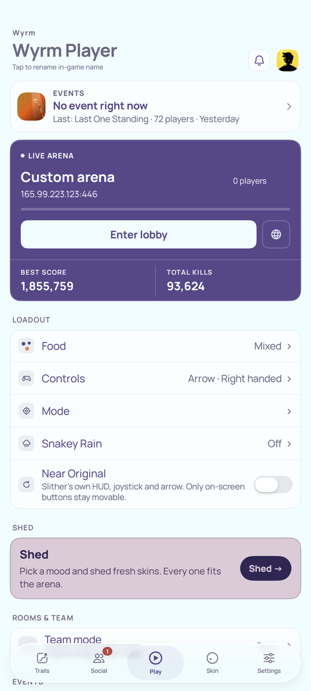
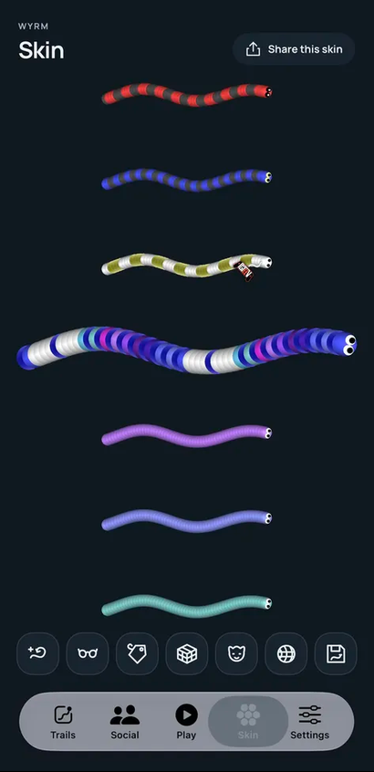
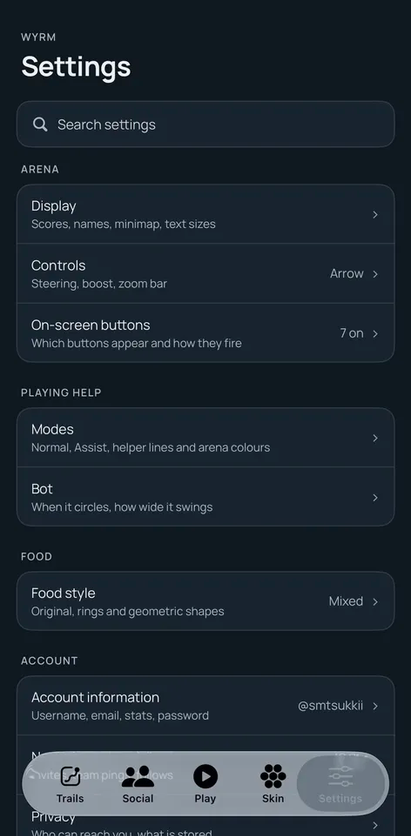
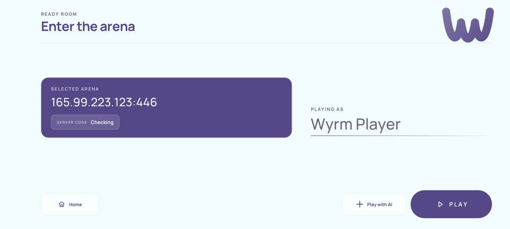

<p align="center">
  
</p>

<h1 align="center">Wyrm for Android</h1>

<p align="center">
  The slither game app I've been building, on your Android phone.<br>
  Needs Android 8.0 or newer.
</p>

<p align="center">
  <a href="https://github.com/disis-om/wyrm-android/releases/latest"><b>⬇&nbsp; Download the latest version</b></a>
</p>

<p align="center">
  &nbsp;
  &nbsp;
  
</p>

---

Hey! This is the Android version of Wyrm. Same account, same skins, same
friends as on iPhone, Windows and Mac. Log in and your settings follow you.

It plays on the real slither.io servers with its own fast engine (C and
Vulkan), so it stays smooth and high FPS even when the arena gets crowded. On
top of that you get skins you build bead by bead, team play, global chat, a
live leaderboard, Trails, assist mode, Snakey Rain and a lot of controls to
make it feel the way you like.

<p align="center">
  
</p>

## Installing

1. Download `Wyrm-v<version>.apk` from the
   [latest release](https://github.com/disis-om/wyrm-android/releases/latest).
2. Open it. If Android asks, allow your browser or file manager to
   **install unknown apps**.
3. Tap **Install**, then open Wyrm, create an account or log in, and play.

If you already have Wyrm, just install the new APK over it. Your account and
settings stay.

There's also a step by step guide on
[wyrm.web.app](https://wyrm.web.app/download/android).

## "Play Protect" warning? That's normal

Wyrm isn't on the Play Store, so Google doesn't know it. If Play Protect warns
you, tap **More details › Install anyway**. Every Wyrm build is signed with the
same key, so Android only ever installs it over Wyrm if it's really mine.

## Updates

You don't need to come back here for new versions. Wyrm checks by itself, and
when there's a new one you'll get a card in the app. Tap **Update now**, it
downloads, checks the file and installs it.

You can also check yourself in **Settings › Updates**. Turn on
**Beta updates** there if you want new stuff a bit earlier than everyone else.

Every update is signed by me, and Wyrm won't install anything whose
signature, size or checksum doesn't match.

## Something not working?

Send me a message in Wyrm (Settings › Help & feedback) or on Discord and tell
me your phone model and Android version. Crash reports are only sent if you
say yes.

<details>
<summary>For developers: building from source</summary>

<br>

A native C engine draws the arena with Vulkan; Jetpack Compose draws
everything around it.

| Path | What's in it |
| --- | --- |
| `app/src/` | C engine: gameplay, slither protocol, renderer, touch controls, JNI |
| `app/res/` | Fonts, textures and shader sources |
| `android/` | The Gradle project (Kotlin/Java) |
| `android-sdl/`, `thermite/`, `glfw/` | SDL3, the Vulkan framework, the desktop window library |
| `update/` | The signed update manifests the app reads |

You need JDK 17 (the Android Studio JBR), Android SDK 36, NDK
`28.2.13676358`, CMake `3.22.1` and an ARM64 phone with Vulkan.

1. Generate the shaders with `python build.py` (needs `slangc`).
2. Add your own Firebase `android/app/google-services.json`.
3. Build:

   ```powershell
   cd android
   .\gradlew.bat :app:assembleDebug "-PWYRM_VERSION_CODE=900" "-PWYRM_VERSION_NAME=9.0.0"
   ```

Release signing keys are private and not in this repository, so a debug build
can't replace the official app. No keys, passwords or player data are stored
here, only the updater's public key.

</details> 

---

<p align="center">GPL-3.0, see <code>LICENSE</code> and <code>NOTICE</code>. © 2026 OM Rajput<br>
Slither.io names and artwork belong to their owners. Wyrm is independent and not affiliated with the game's developer.</p>
